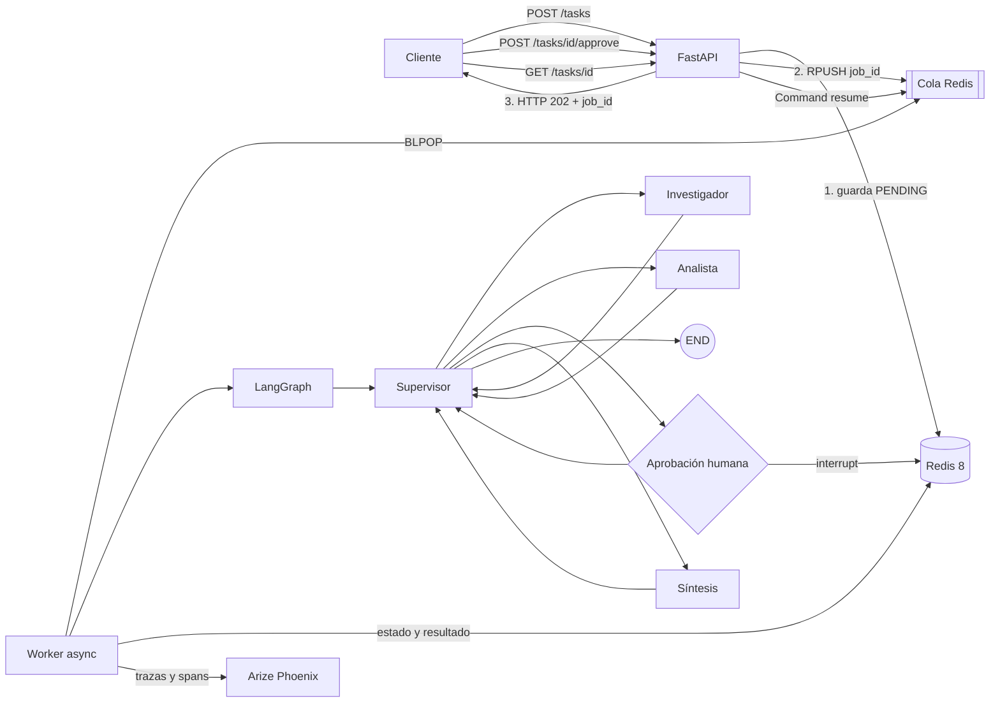

# Pre-entrega 7 — API de producción y monitoreo activo

API REST asíncrona en Python 3.12 que expone un orquestador multi-agente de LangGraph sin ejecutar
el trabajo pesado dentro del request HTTP. FastAPI registra la tarea en Redis y devuelve un
`job_id`; un worker independiente procesa el grafo, persiste checkpoints, exporta trazas a Arize
Phoenix y pausa las tareas críticas hasta recibir aprobación humana.

> **Estado de la evidencia:** el código, los tests y la automatización están completos. Las tres
> capturas reales del dashboard requieren una corrida con una API key propia y deben agregarse en
> `screenshots/` antes de entregar. No se incluyen capturas ni costos inventados.

## Arquitectura



El orden importante al crear una tarea es:

1. Guardar el registro `PENDING`.
2. Publicar el `job_id` en la cola.
3. Responder `202 Accepted`.

Así el worker nunca puede recibir un identificador cuyo estado todavía no exista.

## Componentes

| Componente | Responsabilidad | Qué no hace |
|---|---|---|
| FastAPI | Valida, persiste, encola y permite polling/aprobación | No ejecuta el agente |
| Redis | Guarda jobs, cola y checkpoints | No razona ni procesa prompts |
| Worker | Consume jobs y ejecuta/reanuda LangGraph | No atiende requests HTTP |
| Supervisor | Decide el próximo especialista según el estado | No investiga ni redacta |
| Investigador | Produce evidencia estructurada | No decide acciones críticas |
| Analista | Interpreta evidencia y clasifica riesgo | No aprueba la acción |
| HITL | Pausa con `interrupt()` y recibe `Command(resume=...)` | No ejecuta efectos externos |
| Síntesis | Produce la respuesta final validada | No cambia la decisión humana |
| Phoenix | Recibe trazas OpenTelemetry/OpenInference | No reemplaza tests unitarios |

## Estados de un job

```text
PENDING → RUNNING → DONE
                 ↘ FAILED
                 ↘ WAITING_APPROVAL → PENDING → RUNNING → DONE
```

- `PENDING`: persistido y visible para el cliente; espera un worker.
- `RUNNING`: el worker está ejecutando o reanudando el grafo.
- `WAITING_APPROVAL`: LangGraph guardó el checkpoint y está pausado.
- `DONE`: existe un `FinalReport` validado.
- `FAILED`: una excepción fue capturada y almacenada; el polling no queda infinito.

## Estructura

```text
Entrega 7/
├── app/
│   ├── main.py              # Endpoints FastAPI y lifespan
│   ├── worker.py            # Consumidor Redis y ejecución del grafo
│   ├── graph.py             # Supervisor + especialistas
│   ├── hitl.py              # interrupt() y decisión humana
│   ├── repository.py        # Jobs, cola y transiciones Redis
│   ├── observability.py     # Phoenix/OpenTelemetry
│   ├── schemas.py           # Contratos Pydantic
│   └── config.py            # Variables de entorno
├── scripts/load_test.py     # Cinco requests concurrentes y p95 local
├── tests/
├── docs/resumen_modulo_7.html
├── screenshots/
├── Dockerfile
├── docker-compose.yml
├── requirements.txt
├── pyproject.toml
└── .env.example
```

## Requisitos

- Python 3.12 o 3.13.
- Docker Desktop con `docker compose` para la ejecución completa.
- Una `OPENAI_API_KEY` solamente para la corrida real de costos.

Redis 8 se usa porque el checkpointer `langgraph-checkpoint-redis` requiere RedisJSON y
RediSearch. Esos módulos están incluidos en Redis 8.

## Instalación local para desarrollar

```bash
python3.12 -m venv .venv
source .venv/bin/activate
python -m pip install --upgrade pip
python -m pip install -e ".[dev]"
cp .env.example .env
```

En Windows, la activación es `.venv\Scripts\activate`.

## Modos de ejecución

### `AGENT_MODE=simulated`

Es el modo predeterminado. Ejecuta el mismo Supervisor, flujo HITL, Redis y Phoenix, pero los tres
especialistas son determinísticos. Sirve para aprender, probar infraestructura y evitar costos.

### `AGENT_MODE=openai`

Usa `ChatOpenAI` con salidas estructuradas. Phoenix captura automáticamente las invocaciones y sus
tokens. Es el modo necesario para la captura real de costo por ejecución.

```dotenv
AGENT_MODE=openai
OPENAI_API_KEY=tu_clave_real_solo_en_env_local
```

`.env` está ignorado por Git. Nunca escribas la clave en `.env.example`, README, screenshots o
comandos compartidos.

## Levantar todo con Docker Compose

```bash
cp .env.example .env
docker compose up --build
```

`.env` es opcional para Compose (`required: false`, Docker Compose 2.24 o superior): sin él, el
stack arranca en modo simulado. Para el modo OpenAI es obligatorio.

> **Estado de verificación:** el stack Docker todavía no se ejecutó en la máquina de desarrollo
> porque Docker no está instalado allí. `docker-compose.yml` está validado solo de forma estática.

Servicios:

- API y Swagger: <http://localhost:8000/docs>
- Phoenix: <http://localhost:6006>
- Redis: `localhost:6379`

La API y el worker son procesos separados. Crear un `asyncio.create_task(worker())` dentro del
proceso web no ofrece el mismo aislamiento y se perdería al escalar Uvicorn a varias réplicas.

## Probar una tarea no crítica

Crear:

```bash
curl -i -X POST http://localhost:8000/tasks \
  -H 'Content-Type: application/json' \
  -d '{"query":"Explicá cómo Redis desacopla FastAPI de un agente lento","force_critical":false}'
```

La API devuelve `202 Accepted` inmediatamente:

```json
{
  "job_id": "c5f...",
  "status": "PENDING",
  "status_url": "/tasks/c5f..."
}
```

Consultar:

```bash
curl http://localhost:8000/tasks/REEMPLAZAR_JOB_ID
```

## Probar Human-in-the-loop

Forzar una operación crítica:

```bash
curl -X POST http://localhost:8000/tasks \
  -H 'Content-Type: application/json' \
  -d '{"query":"Procesá un reembolso de USD 2500","force_critical":true}'
```

El polling llegará a `WAITING_APPROVAL`. Para aprobar:

```bash
curl -X POST http://localhost:8000/tasks/REEMPLAZAR_JOB_ID/approve \
  -H 'Content-Type: application/json' \
  -d '{"approved":true,"reviewer":"Rocco","comment":"Revisado"}'
```

El endpoint guarda la decisión, vuelve a encolar el mismo `job_id` y el worker reanuda su
checkpoint con `Command(resume=...)`. El nodo de aprobación se ejecuta desde el principio, por eso
no contiene efectos secundarios antes de `interrupt()`.

## Prueba de carga: cinco solicitudes concurrentes

Con el stack levantado:

```bash
python scripts/load_test.py
```

El script usa `asyncio.gather`, espera los cinco resultados (con `--timeout`, 180 s por defecto,
para no quedar colgado si el worker no está corriendo) y crea
`reports/load_test_results.json`. Su p95 HTTP local sirve como contraste; la métrica que pide la
rúbrica debe capturarse desde Phoenix.

## Evidencia para entregar

Para producir evidencia real:

1. Configurá `AGENT_MODE=openai` y tu key únicamente en `.env`.
2. Ejecutá `docker compose up --build`.
3. Abrí Phoenix en <http://localhost:6006>.
4. Ejecutá `python scripts/load_test.py`.
5. Filtrá el proyecto `pre-entrega-7` y las cinco trazas de esa corrida.
6. Esperá unos segundos para que el exportador batch termine de enviar spans.
7. Guardá en `screenshots/`:
   - `01-trace-completa.png`: árbol de spans de una ejecución.
   - `02-costos-por-ejecucion.png`: costos calculados desde tokens reales.
   - `03-latencia-p95.png`: latencia p95 de las cinco peticiones.
8. Revisá que ninguna captura muestre API keys, prompts sensibles o datos personales.
9. Agregá las imágenes al commit final.

No uses las métricas del modo simulado como evidencia de costo: no consume tokens reales.

## Observabilidad

`phoenix.otel.register(auto_instrument=True)` activa los instrumentadores OpenInference instalados
para LangChain y OpenAI. El worker también crea un span raíz `agent.job` con:

- `job.id`
- `job.agent_mode`
- `job.resume`
- `job.outcome`

Los spans permiten distinguir la latencia total del job de las invocaciones a especialistas y al
modelo. Las trazas son herramientas de diagnóstico; no deben almacenar razonamiento privado ni
secretos.

## Tests y calidad

```bash
pytest -q
ruff check .
mypy app tests
```

Además:

```bash
python - <<'PY'
import yaml
yaml.safe_load(open("docker-compose.yml", encoding="utf-8"))
print("docker-compose.yml válido")
PY
```

Las pruebas usan `fakeredis` e `InMemorySaver`; no consumen tokens y no requieren Docker.

## Decisiones de seguridad y resiliencia

- El request HTTP nunca invoca al LLM.
- Un fallo del agente actualiza el job a `FAILED`.
- El worker reclama el job con una transición atómica `PENDING → RUNNING` (`WATCH/MULTI`): un ID
  duplicado en la cola o un segundo worker nunca ejecutan ni reanudan el grafo dos veces.
- Un `job_id` vencido por TTL o inexistente se descarta con un warning; no detiene al worker.
- La decisión HITL se guarda y reencola atómicamente mediante `WATCH/MULTI`.
- Solo se aprueban jobs en `WAITING_APPROVAL`; el resto recibe HTTP `409`.
- Los jobs tienen TTL configurable para controlar el crecimiento de Redis.
- `recursion_limit` limita ejecuciones defectuosas del grafo.
- Las salidas se validan con Pydantic.
- API y worker cierran sus conexiones Redis de forma ordenada.

## Limitaciones conocidas

- La cola basada en Redis List es apropiada para esta pre-entrega. Un sistema crítico debería usar
  Redis Streams, consumer groups o una cola como Celery/ARQ para acknowledgements y reentrega si
  un worker muere después de `BLPOP`.
- Si el proceso worker muere o se cancela (`CancelledError`, `docker compose down`) mientras un job
  está en `RUNNING`, ese job queda en `RUNNING` hasta su TTL: la Redis List no tiene
  acknowledgements. La evolución natural es Redis Streams con `XREADGROUP` + `XAUTOCLAIM`, o un
  patrón `BLMOVE` a una lista de procesamiento con un reaper.
- La API no incluye autenticación; el endpoint de aprobación debe protegerse antes de producción.
- Las capturas dependen de una ejecución real y no pueden generarse honestamente sin credenciales.
- Redis y Phoenix usan imágenes `latest`/minor en la demo; producción debería fijar imágenes por
  digest después de una revisión de seguridad.

## Detener el entorno

```bash
docker compose down
```

Para borrar también los volúmenes locales de esta demo:

```bash
docker compose down -v
```

## Referencias oficiales utilizadas

- [FastAPI: eventos lifespan](https://fastapi.tiangolo.com/advanced/events/)
- [LangGraph: `interrupt()`](https://reference.langchain.com/python/langgraph/types/interrupt)
- [LangGraph: `Command`](https://reference.langchain.com/python/langgraph/types/Command)
- [LangGraph Redis](https://github.com/redis-developer/langgraph-redis)
- [Phoenix: configuración de trazas](https://arize.com/docs/phoenix/tracing/how-to-tracing/setup-tracing/custom-spans)
- [Phoenix: despliegue local](https://arize.com/docs/phoenix/self-hosting/deploying-phoenix)
